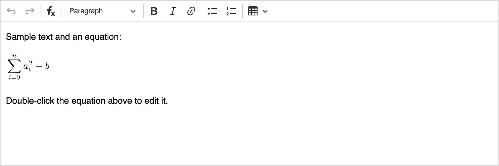
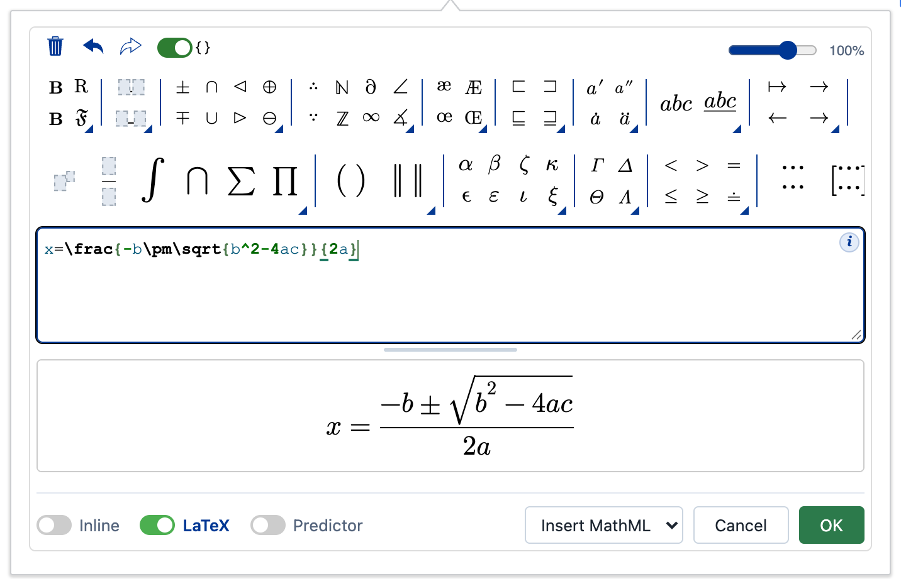

# fxEditor for CKEditor 5

The fxEditor plugin for [CKEditor 5](https://ckeditor.com/ckeditor-5/) (v42 or later) adds an
**fx** button to the editor's toolbar. It opens fxEditor, CodeCogs' equation editor, in a
balloon: a toolbar of symbols and structures, a maths view you type into directly, and a LaTeX
view that stays in step with it. The equation goes into the document as MathML (the default) or
as an SVG image, chosen in the balloon. Double-click an inserted equation to edit it again.

This repository has two parts:

- [`plugin/`](plugin/) - the plugin itself, published on npm as
  [`@codecogs/fxeditor-ckeditor5`](https://www.npmjs.com/package/@codecogs/fxeditor-ckeditor5).
  It is a single ES module, [`plugin/src/index.js`](plugin/src/index.js).
- [`demo/`](demo/) - the example app shown on the documentation page: an ordinary CKEditor 5
  integration, bundled from npm sources, that loads the plugin from `../plugin`.

CKEditor 5 itself is the work of CKSource and is licensed separately; it is not part of this
repository.

## Screenshots



*The fx button on CKEditor 5's toolbar.*



*fxEditor open in CKEditor 5, with the LaTeX view shown above the maths view.*

## Links

- [Documentation and live demo](https://fxplugins.codecogs.com/docs/ckeditor5.html)
- [Customise and download](https://fxplugins.codecogs.com/docs/ckeditor5.html#customise) - design
  the editor's look and download the result
- [All fxEditor plugins](https://fxplugins.codecogs.com)
- [fxEditor](https://fxeditor.codecogs.com)

## Installing from npm

```bash
npm install ckeditor5 @codecogs/fxeditor-ckeditor5
```

The package is being published to npm. Until it appears there, install it from git as below.

## Installing from git

```bash
git clone https://github.com/willzyba/ckeditor_v5.git
```

Then, in your own project, install the plugin from the clone's `plugin/` folder, alongside
CKEditor 5 itself:

```bash
npm install ckeditor5 /path/to/ckeditor_v5/plugin
```

This is the same arrangement `demo/package.json` uses (`"@codecogs/fxeditor-ckeditor5":
"file:../plugin"`). Either way the package is imported as `@codecogs/fxeditor-ckeditor5`.

CKEditor 5 has to be bundled from its npm sources with your usual bundler (esbuild, webpack,
Vite and so on): its GPL licence key is accepted only on the npm distribution channel, and the
editor refuses to start with `license-key-invalid-distribution-channel` if you load its prebuilt
browser file from a CDN instead. See [`demo/README.md`](demo/README.md).

## Usage

Import the plugin alongside your other CKEditor imports, add it to both `plugins` and `toolbar`
(the toolbar item is `EqnEditor5`), and give it your fxEditor licence key under `eqnEditor`. The
Image plugins are needed only if equations may be inserted as images.

```js
import { ClassicEditor, Essentials, Paragraph, Bold, Italic,
         Image, ImageInline, ImageToolbar, ImageTextAlternative } from 'ckeditor5';
import { eqnEditor5 } from '@codecogs/fxeditor-ckeditor5';
import 'ckeditor5/ckeditor5.css';

ClassicEditor.create( document.querySelector( '#editor' ), {
    licenseKey: 'GPL',                       // CKEditor's own licence
    plugins: [ Essentials, Paragraph, Bold, Italic,
               Image, ImageInline, ImageToolbar, ImageTextAlternative,
               eqnEditor5 ],
    toolbar: [ 'undo', 'redo', '|', 'bold', 'italic', '|', 'EqnEditor5' ],
    eqnEditor: {
        licence: 'YOUR-FXEDITOR-LICENCE-KEY',   // fxEditor's licence, from fxeditor.codecogs.com/purchase
        design: { colour: '#0f7a4d' }           // optional
    }
} );
```

That is the whole integration. The equation editor itself is fetched from `fxtex.codecogs.com`
the first time it is needed, so there is nothing further to bundle and you always get the current
editor. The plugin teaches CKEditor to keep MathML, so there is no schema for you to maintain.

To use it: click where the equation should go, click **fx**, build the equation, choose MathML
or an image from the dropdown beside the toggles, and insert it. Double-click an equation to
edit it again; both kinds carry the LaTeX they were written from.

MathML needs a stylesheet on the page that displays it. The plugin loads it into the editing
view for you; on the page that finally shows your content, add:

```html
<link rel="stylesheet" href="https://fxtex.codecogs.com/fxtex.css">
```

### Running the demo

```bash
cd ckeditor_v5/demo
npm install
npm run build
```

`npm run build` writes `dist/eqneditor-ckeditor5-demo.js` and `dist/ckeditor5.css`, which
`demo/example.html` loads. Before opening `example.html` (through a local web server, as it is
an ES module), replace its two placeholders: `{{EQN_SERVER}}` with `fxtex.codecogs.com` and
`{{FXTEXPRO_KEY}}` with your licence key. The documentation site fills these in when it
publishes the demo.

## Licence key

Equations are rendered by fxTeX Pro, which needs a licence key for your domain. Without one,
equations show the reason they cannot render in place of the maths.

Get your licence key from [fxeditor.codecogs.com/purchase](https://fxeditor.codecogs.com/purchase).

The key goes in `eqnEditor.licence`. Note there are two licence keys here, for two products:
`licenseKey` is CKEditor's own; `eqnEditor.licence` is fxEditor's.

### Options

Every option lives under the `eqnEditor` key.

| Option | Default | Meaning |
|---|---|---|
| `licence` | | Your fxEditor licence key. Required. |
| `design` | | The editor's look: dialog width, height and scale, toolbar panels and size, colour, equation and markup sizes, undo/redo, how the dialog opens. Build one in [Customise and download](https://fxplugins.codecogs.com/docs/ckeditor5.html#customise). |
| `server` | `'fxtex.codecogs.com'` | Host the equation editor's own code is loaded from. A bare host means https; a full origin is used as it is. |
| `renderUrl` | `'https://latex.codecogs.com'` | The rendering service for equations inserted as images. Point it at a self-hosted fxTeX Server to keep equations inside your network. |
| `scriptUrl` | from `server` | Full URL of the equation editor bundle, when the default path does not suit. |
| `cssUrl` | from `server` | Full URL of the equation editor stylesheet. |
| `mathmlCssUrl` | from `server` | The MathML stylesheet loaded into the editing view. |

`insertAs`, `showLatex` and `latexDisplay` from earlier versions are no longer read: the author
chooses MathML or an image in the balloon, and shows or hides the LaTeX with its toggle.

## Licence

Copyright (c) 2026 CodeCogs, Zyba Ltd.

The plugin and the demo are released under the MIT licence - see
[`LICENSE`](https://github.com/willzyba/ckeditor_v5/blob/main/LICENSE) (and, for the npm package,
[`plugin/LICENSE.md`](https://github.com/willzyba/ckeditor_v5/blob/main/plugin/LICENSE.md)).

CKEditor 5 is CKSource's and is licensed separately (the examples use its GPL licence key,
`'GPL'`). fxEditor and fxTeX Pro need their own licence key, as above.
