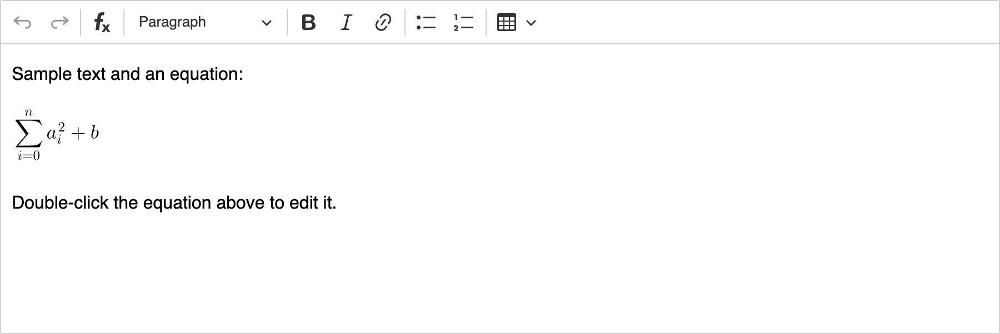
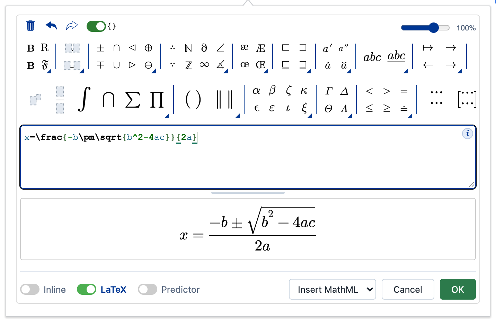

# fxEditor for CKEditor 5

`@codecogs/fxeditor-ckeditor5` adds an **fx** button to the toolbar of
[CKEditor 5](https://ckeditor.com/ckeditor-5/) (v42 or later). It opens
[fxEditor](https://fxeditor.codecogs.com), CodeCogs' equation editor, in a balloon: a toolbar of
symbols and structures, a maths view you type into directly, and a LaTeX view that stays in step
with it. The equation goes into the document as MathML (the default) or as an SVG image, chosen
in the balloon. Double-click an inserted equation to edit it again.



*The fx button on CKEditor 5's toolbar.*



*fxEditor open in CKEditor 5, with the LaTeX view shown above the maths view.*

## Links

- [Documentation and live demo](https://fxplugins.codecogs.com/docs/ckeditor5.html)
- [Customise and download](https://fxplugins.codecogs.com/docs/ckeditor5.html#customise)
- [All fxEditor plugins](https://fxplugins.codecogs.com)
- [fxEditor](https://fxeditor.codecogs.com)
- [Source on GitHub](https://github.com/willzyba/ckeditor_v5)

## Install

```bash
npm install ckeditor5 @codecogs/fxeditor-ckeditor5
```

The package is being published to npm. Until it appears there, install it from git:

```bash
git clone https://github.com/willzyba/ckeditor_v5.git
npm install ckeditor5 /path/to/ckeditor_v5/plugin
```

CKEditor 5 must be bundled from its npm sources with your usual bundler: its GPL licence key is
accepted only on the npm distribution channel, not with its prebuilt browser file from a CDN.

## Use

Import it alongside your other CKEditor imports, add it to both `plugins` and `toolbar` (the
toolbar item is `EqnEditor5`), and give it your fxEditor licence key. The Image plugins are
needed only if equations may be inserted as images.

```js
import { ClassicEditor, Essentials, Paragraph, Bold, Italic,
         Image, ImageInline, ImageToolbar, ImageTextAlternative } from 'ckeditor5';
import { eqnEditor5 } from '@codecogs/fxeditor-ckeditor5';
import 'ckeditor5/ckeditor5.css';

ClassicEditor.create( document.querySelector( '#editor' ), {
    licenseKey: 'GPL',                       // CKEditor's own licence
    plugins: [ Essentials, Paragraph, Bold, Italic,
               Image, ImageInline, ImageToolbar, ImageTextAlternative,
               eqnEditor5 ],
    toolbar: [ 'undo', 'redo', '|', 'bold', 'italic', '|', 'EqnEditor5' ],
    eqnEditor: {
        licence: 'YOUR-FXEDITOR-LICENCE-KEY',   // fxEditor's licence, from fxeditor.codecogs.com/purchase
        design: { colour: '#0f7a4d' }           // optional
    }
} );
```

That is the whole integration. The equation editor itself is fetched from `fxtex.codecogs.com`
the first time it is needed, so there is nothing further to bundle and you always get the current
editor. The plugin teaches CKEditor to keep MathML, so there is no schema for you to maintain.

MathML needs a stylesheet on the page that displays it. The plugin loads it into the editing
view for you; on the page that finally shows your content, add:

```html
<link rel="stylesheet" href="https://fxtex.codecogs.com/fxtex.css">
```

## Licence key

Equations are rendered by fxTeX Pro, which needs a licence key for your domain. Without one,
equations show the reason they cannot render in place of the maths.

Get your licence key from [fxeditor.codecogs.com/purchase](https://fxeditor.codecogs.com/purchase).

The key goes in `eqnEditor.licence`. There are two licence keys, for two products: `licenseKey`
is CKEditor's own; `eqnEditor.licence` is fxEditor's.

## Options (`eqnEditor`)

| Option | Default | Meaning |
|---|---|---|
| `licence` | | Your fxEditor licence key. Required. |
| `design` | | The editor's look: dialog width, height and scale, toolbar panels and size, colour, equation and markup sizes, undo/redo, how the dialog opens. Build one in [Customise and download](https://fxplugins.codecogs.com/docs/ckeditor5.html#customise). |
| `server` | `'fxtex.codecogs.com'` | Host the equation editor's own code is loaded from. A bare host means https; a full origin is used as it is. |
| `renderUrl` | `'https://latex.codecogs.com'` | The rendering service for equations inserted as images. Point it at a self-hosted fxTeX Server to keep equations inside your network. |
| `scriptUrl` | from `server` | Full URL of the equation editor bundle, when the default path does not suit. |
| `cssUrl` | from `server` | Full URL of the equation editor stylesheet. |
| `mathmlCssUrl` | from `server` | The MathML stylesheet loaded into the editing view. |

## Licence

Copyright (c) 2026 CodeCogs, Zyba Ltd. Released under the MIT licence - see
[LICENSE.md](https://github.com/willzyba/ckeditor_v5/blob/main/plugin/LICENSE.md).
CKEditor 5 is CKSource's and is licensed separately. fxEditor needs its own licence key, as above.
